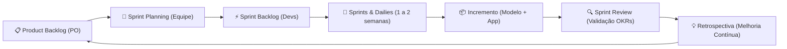

# Organização da Equipe e Metodologia Ágil (Scrum)

> **Residência em Inteligência Artificial (UnB / Instituto Eldorado)**  
> **Challenge 01: Detecção de Desinformação**  
> **Projeto:** Lume

---

## 👥 1. Alocação da Equipe

A equipe é estruturada no modelo ágil Scrum, com papéis e responsabilidades claramente definidos:

| Papel | Responsável | Atribuições Principais |
| :--- | :--- | :--- |
| **Product Owner (PO)** | **Maria Luisa Oliveira Lima** | • Visão do produto Lume e alinhamento estratégico com os OKRs da Residência. • Definição, priorização e refinamento contínuo do *Product Backlog*. • Critérios de aceitação para requisitos funcionais e não funcionais. • Validação das entregas parciais e alinhamento com stakeholders. |
| **Scrum Master (SM)** | **Jhecy Ketlin Gomes Vieira** | • Facilitação das cerimônias ágeis (*Planning*, *Dailies*, *Review*, *Retrospective*). • Identificação e remoção ativa de impedimentos técnicos e organizacionais. • Gestão do fluxo de trabalho, prazos e ritmo sustentável da equipe. • Promoção de boas práticas ágeis e colaboração entre pesquisa e engenharia. |
| **Equipe de Desenvolvimento (Devs)** | **Matheus Henrique Picone Rosa** | • Arquitetura de Machine Learning e modelagem preditiva. • Pipeline do modelo "mesmo fato" (Regressão Logística, BERTimbau, MPNet). • Redação e validação do relatório técnico e cofre da prova lacrada. |
| | **Pedro Henrique Gonçalves de Oliveira** | • Engenharia de software e integração de componentes. • Desenvolvimento de pipelines de dados e suporte ao backend/OCR. |
| | **Guilherme Bastos Moreira** | • Concepção do MVP inicial e algoritmos de busca de fontes. • Estruturação de dados e integração com serviços locais e remotos. |
| | **Ana Paula Gomes de Matos** | • Processamento de Linguagem Natural (PLN) e análise textual. • Auditoria de dados, exploração de corpus e avaliação de baselines (FakeRecogna). |

---

## 🔄 2. Dinâmica do Scrum no Projeto

O projeto adotou práticas ágeis adaptadas ao contexto de **Pesquisa e Desenvolvimento em Inteligência Artificial (Data Science / MLOps)**:

### Cerimônias Realizadas
1. **Sprint Planning:** Definição da meta de cada ciclo (ex.: *Auditoria e Prova de Leakage no LIAR2*, *Baseline em Português com FakeRecogna*, *Pipeline do Modelo 'Mesmo Fato'*, *Desenvolvimento do Mascote e App Lume*).
2. **Daily Standups (Sincronizações):** Alinhamentos frequentes para comunicação de avanços, dependências entre modelos e interface, e bloqueios.
3. **Sprint Review & Entrega:** Demonstração do incremento do produto (ex.: APK funcional da demo 0.3.0, cadernos de avaliação e relatórios técnicos).
4. **Retrospectiva:** Lições aprendidas metodológicas (ex.: descarte do dataset ISOT por atalho de fonte, isolamento da prova lacrada sem contaminação, decisão de não fornecer percentual falso de confiança no app).

---

## ✅ 3. Definição de Pronto (Definition of Done - DoD)

Para assegurar o rigor técnico e científico exigido pela UnB e pelo Instituto Eldorado, uma tarefa de modelagem ou desenvolvimento só é considerada **Pronta (Done)** quando cumpre:

### Para Modelos de IA e Ciência de Dados:
- [x] Ausência comprovada de vazamento de dados (*data leakage* auditado e documentado).
- [x] Conjunto de teste lacrado avaliado uma única vez no relatório final.
- [x] Métricas calculadas com intervalos de confiança estatísticos (ex.: *bootstrap* de 95%).
- [x] Ficha do modelo preenchida (`ficha-do-modelo.md`) especificando entradas, saídas e limitações.
- [x] Notebook de avaliação reprodutível em máquina convencional em menos de 1 minuto (`avaliar_o_modelo.ipynb`).

### Para Código de Software e Produto (Lume):
- [x] Cobertura de testes unitários automatizados (Android, Servidor e Web).
- [x] Funcionamento seguro e offline (variante demo não realiza requisições indevidas).
- [x] Conformidade com os requisitos de privacidade (dados não saem do dispositivo).
- [x] Documentação técnica e instruções de execução atualizadas no `README.md`.

